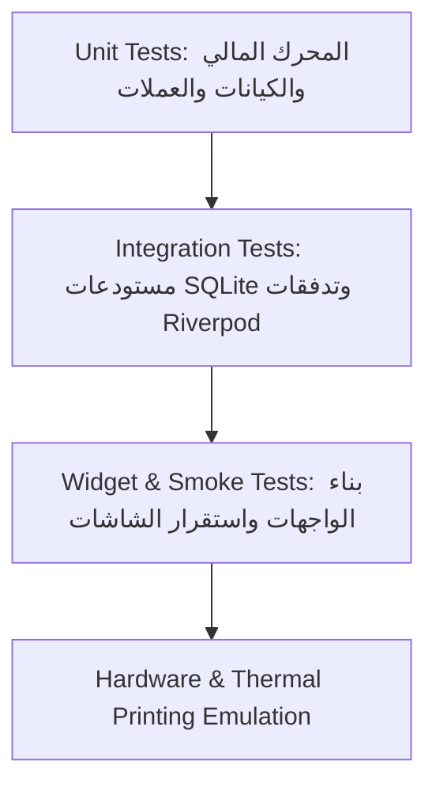

# خطة الاختبارات والتحقق (Testing Plan)
## مشروع صبر إلكترونكس (Sabr Electronics)

---

## 1. استراتيجية الاختبارات (Testing Strategy)

يعتمد النظام على نهج الاختبارات الهرمي التراكمي لضمان عدم حدوث أي تراجع (Zero Regressions) في العمليات الحسابية وقواعد البيانات:

---

## 2. مصفوفة الاختبارات المنفذة (Executed Test Suites)

| ملف الاختبار | نوع الفحص | الحالات التي يتم اختبارها | الحالة |
| :--- | :--- | :--- | :--- |
| [`test/database_test.dart`](file:///e:/AI_Studio/test/database_test.dart) | قاعدة البيانات والترقية | ترقية الإصدار إلى `v2`، القيود الخارجية Foreign Keys، حفظ العملات المتعددة، والعمليات الحسابية التراكمية. | ✅ ناجح |
| [`test/repair_test.dart`](file:///e:/AI_Studio/test/repair_test.dart) | المحرك المالي وإحصائيات لوحة التحكم | الحفاظ على التكلفة التقديرية كأساس للإجمالي، احتساب أجور اليد والقطع والخصم، واستعلامات KPI الفورية. | ✅ ناجح |
| [`test/spare_parts_test.dart`](file:///e:/AI_Studio/test/spare_parts_test.dart) | مستودع قطع الغيار | البحث بالرمز المرجعي، فئات القطع، كشف النواقص الحرجة، ومنع الأرصدة السالبة في المخزن. | ✅ ناجح |
| [`test/settings_test.dart`](file:///e:/AI_Studio/test/settings_test.dart) | نظام الإعدادات وRiverpod | قراءة الإعدادات الافتراضية، التحديث الفردي والشامل في SQLite، ومزامنة الحالة اللحظية عبر `SettingsNotifier`. | ✅ ناجح |
| [`test/backup_test.dart`](file:///e:/AI_Studio/test/backup_test.dart) | خدمة النسخ والتحقق | فحص سلامة ترويسة SQLite، كشف الملفات التالفة، وتنسيق أحجام الملفات والتواريخ. | ✅ ناجح |
| [`test/customer_test.dart`](file:///e:/AI_Studio/test/customer_test.dart) | مستودع وإحصائيات العملاء | إضافة واسترجاع وبحث العملاء، تحديث البيانات، وحساب عدد الأجهزة وتذاكر الصيانة والمديونية الحالية. | ✅ ناجح |
| [`test/audit_test.dart`](file:///e:/AI_Studio/test/audit_test.dart) | سجل الرقابة والتدقيق | تسجيل العمليات الحساسة، الاسترجاع مع الترتيب الزمني التنازلي، والتوثيق المالي. | ✅ ناجح |
| [`test/widget_test.dart`](file:///e:/AI_Studio/test/widget_test.dart) | اختبار بناء التطبيق (Smoke Test) | تحميل `SabrApp` والتأكد من عدم وجود أخطاء صامتة في الواجهة وشجرة العناصر. | ✅ ناجح |

---

## 3. التحقق من جودة الكود والتحليل الساكن

- **أداة الفحص:** `flutter analyze`
- **النتيجة:** `No issues found!` بدون أي أخطاء أو تحذيرات أو عناصر مهملة.
