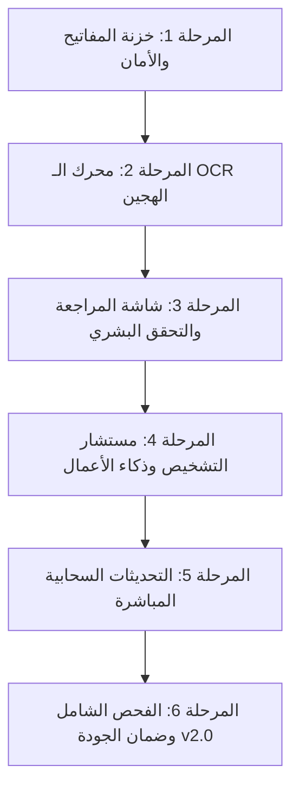

# خطة التنفيذ المفصلة للإصدار الثاني (v2.0 Implementation Plan)
## نظام صَبْر إلكترونكس — طبقة الترقية الذكية (The Smart AI & Hybrid Layer)

---

### ملخص الإصدار
- **اسم التطبيق:** صَبْر إلكترونكس (Sabr Electronics).
- **رقم الإصدار:** v2.0.0.
- **الهدف الجوهري:** ترقية النظام المستقر (v1.0.0) بإضافة طبقة ذكاء اصطناعي هجينة ومساعد فني وتشخيصي، مع الحفاظ الصارم على أداء الورشة الفائق واستمرارية العمل دون إنترنت (Offline-First).
- **المرجع التصميمي:** مهارة [premium-adaptive-ui-design](file:///e:/company's%20business/AI%20Studio/skills/premium-adaptive-ui-design) بنمط **Midnight Indigo** و **Pearl Light**.

---

### القواعد المعمارية والأمنية الصارمة للإصدار الثاني

1. **قاعدة عدم كسر الأساس (Preserve v1.0.0 Core):**
   - لا يتم تعديل بنية الجداول الـ 11 الحالية في قاعدة بيانات SQLite إلا عبر معاملات الترقية الرسمية `onUpgrade` وبنسخ احتياطي تلقائي يسبق أي تغيير.
2. **قاعدة حظر التوليد الصوري (No Generative AI for Device Photos):**
   - يُمنع استخدام الذكاء الاصطناعي التوليدي لتعديل صور الأجهزة؛ توثيق الخدوش والأعطال يتم رقمياً وحتمياً 100% منعاً للمساءلات القانونية.
3. **قاعدة التحقق البشري الإلزامي (Mandatory Human Verification):**
   - لا يُحفظ أي سجل أو حقل مستخرج عبر الـ OCR أو الذكاء الاصطناعي تلقائياً دون مراجعة الموظف والضغط على زر الحفظ البشري.
4. **حظر الكتابة المباشرة للـ AI (Read-Only AI):**
   - المساعد الذكي لا يملك أي وصول تنفيذي للكتابة أو الحذف في قاعدة البيانات.
5. **تقليل وتجريد البيانات (Data Minimization):**
   - لا تُرسل أسماء العملاء أو أرقام هواتفهم للتحليلات السحابية، بل تُرسل أرقام مجردة فقط.
6. **حظر وضع مفاتيح API داخل الكود أو Git:**
   - تخزين المفاتيح يتم محلياً وبشكل مشفر في عتاد الجهاز عبر `flutter_secure_storage`.

---

### المراحل التنفيذية المجدولة (Phases)

---

#### المرحلة 1: خزنة المفاتيح والأمان المحلي (API Vault & Security)
- [ ] إضافة واجهة إدارة مفتاح Gemini داخل شاشة إعدادات التطبيق.
- [ ] تخزين مفتاح `GEMINI_API_KEY` محلياً باستخدام `flutter_secure_storage` وتشفير Keystore/Keychain.
- [ ] زر اختبار فوري لصلاحية المفتاح والاتصال مع خوادم Google AI دون تجميد الواجهة.
- [ ] حماية الوصول لشاشة المفاتيح برمز PIN المدير (Admin Role).

#### المرحلة 2: محرك القراءة البصرية الهجين (Hybrid OCR Engine)
- [ ] **المسار المحلي السريع (On-Device):**
  - دمج `google_mlkit_text_recognition` لقراءة النصوص المطبوعة اللاتينية والأرقام محلياً في أقل من 100ms ودون إنترنت.
  - استخراج ذكي لأرقام السيريال، أرقام الهواتف، وموديلات الأجهزة عبر Regular Expressions محلية متقدمة.
- [ ] **المسار السحابي التكميلي (Gemini Vision):**
  - استدعاء سحابي اختياري عبر نموذج `gemini-2.5-flash` لمعالجة الصور اليدوية المعقدة والفواتير التالفة عند توفر الإنترنت وبطلب مباشر من المستخدم.

#### المرحلة 3: شاشة المراجعة والتحقق البشري (Review & Confidence Screen)
- [ ] تصميم شاشة مراجعة عائمة بنمط **Midnight Indigo** تعرض الصورة الملتقطة جنباً إلى جنب مع الحقول المستخرجة.
- [ ] إظهار شارات الثقة (Confidence Badges):
  - 🟢 أخضر: نسبة ثقة عالية (> 90%).
  - 🟠 برتقالي: نسبة ثقة متوسطة، تتطلب تأكيداً بصرياً من الموظف.
- [ ] أزرار اعتماد سريعة تملأ معالج الاستلام (Intake Wizard) بنقرة واحدة.

#### المرحلة 4: مستشار التشخيص وذكاء الأعمال (Diagnostic Advisor & BI)
- [ ] **مستشار فحص الأعطال (Diagnostic Advisor):**
  - واجهة دردشة استشارية متخصصة في إلكترونيات السيارات، الأجهزة الطبية، ومضخمات الصوت.
  - تزويد النموذج بسياق العطل لاقتراح خطوات القياس بالمتر وفحص دوائر التغذية والشورت.
- [ ] **ذكاء الأعمال (BI & Analytics):**
  - تقارير إحصائية دورية تلخص أكثر الأعطال تكلفة والأجهزة الأكثر ربحية بصيغة بطاقات تفاعلية.
- [ ] **قوالب رسائل الواتساب الذكية:**
  - توليد نصوص إشعار جاهزة للإرسال بنقرة واحدة عبر WhatsApp تتضمن حالة الصيانة وتفاصيل الضمان.

#### المرحلة 5: التحديثات السحابية المباشرة (In-App OTA Updates)
- [ ] ربط التطبيق مع مستودع GitHub Releases لفحص الإصدارات الجديدة عبر ملف `update_manifest.json`.
- [ ] إشعار المستخدم بوجود تحديث جديد مع عرض سجل التغييرات (Release Notes).
- [ ] التحقق التلقائي من تجزئة الأمان `SHA-256` لملف التحديث قبل التثبيت.
- [ ] أخذ نسخة احتياطية أرشيفية كاملة وتلقائية لقاعدة البيانات قبل الترقية لحماية البيانات.

#### المرحلة 6: الفحص الشامل وضمان الجودة (QA & Stability)
- [ ] اختبارات وضع الطيران (Airplane Mode) للتأكد من استمرار عمل 100% من مهام الورشة حتى في حال تعطل الذكاء الاصطناعي.
- [ ] اختبار كفاءة الذاكرة عند معالجة الصور وضمان عدم حدوث Memory Leaks.
- [ ] اختبار دقة الـ OCR على عينات حقيقية من فواتير وأجهزة الورشة.

---
*تم اعتماد هذه الخطة وتوثيقها لتكون المرجع التنفيذي المباشر لكافة عمليات بناء الإصدار الثاني.*
